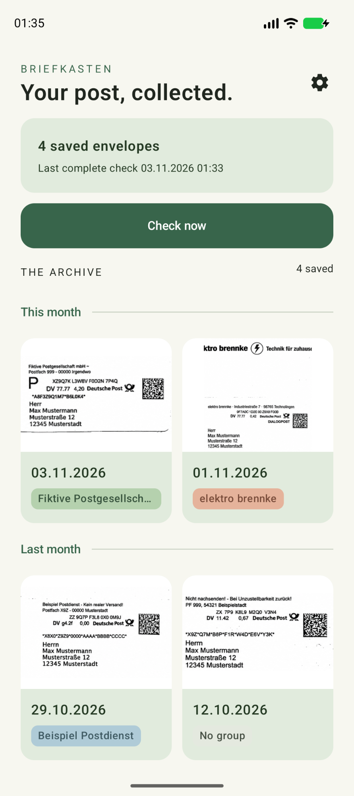
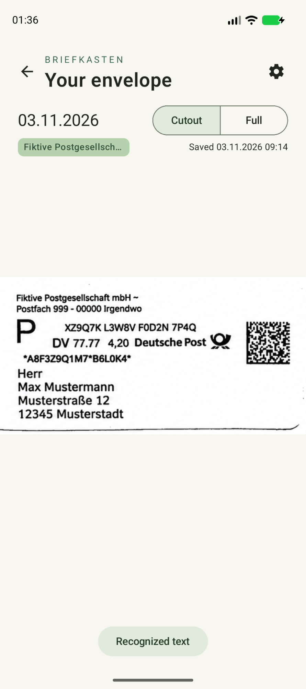
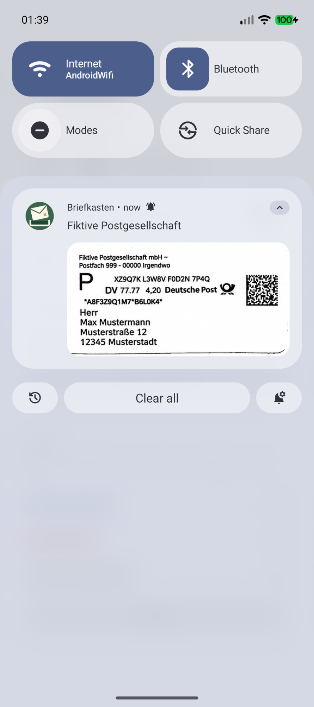
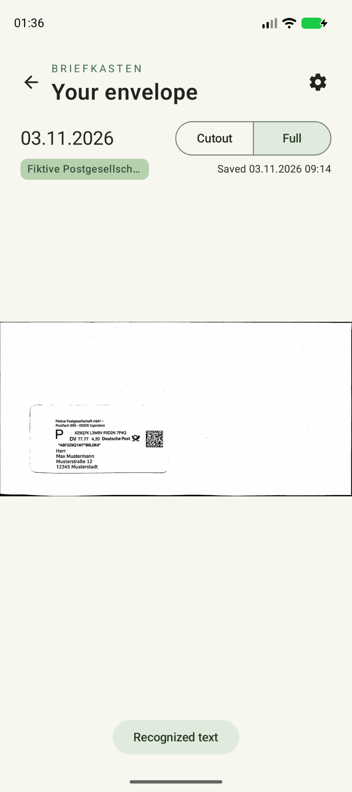
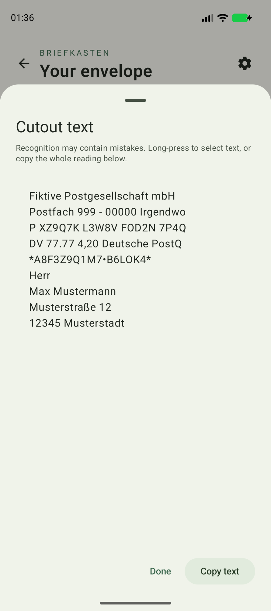
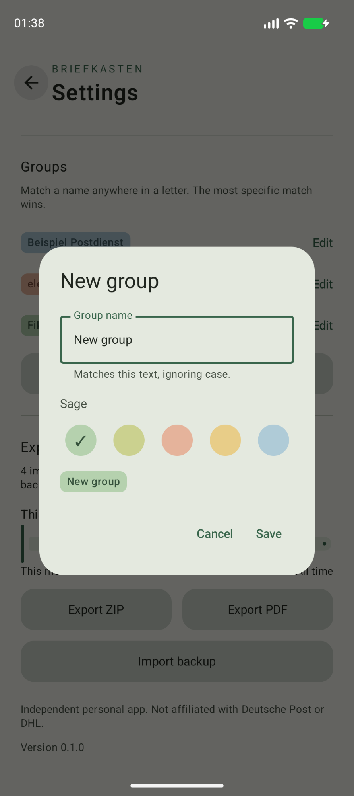
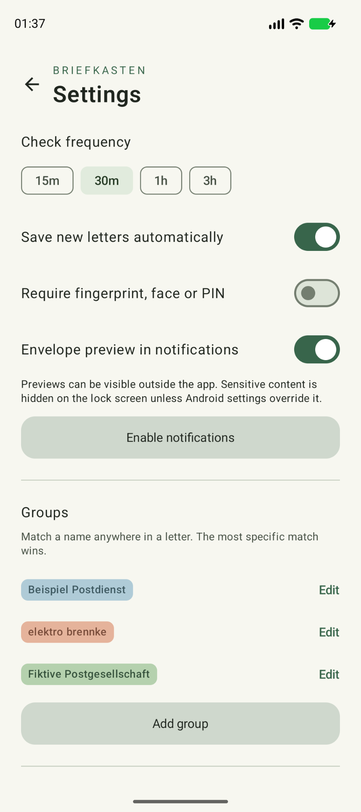
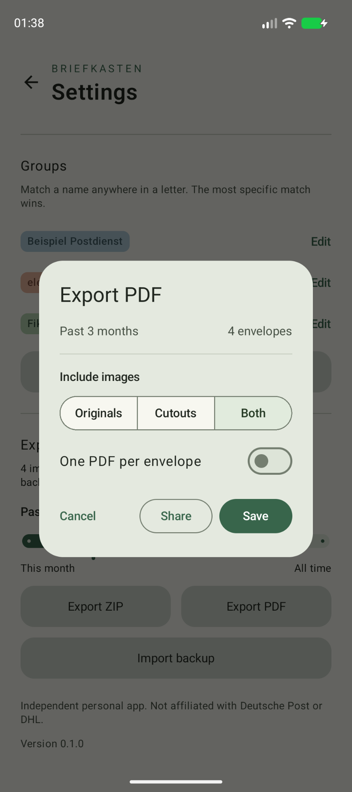
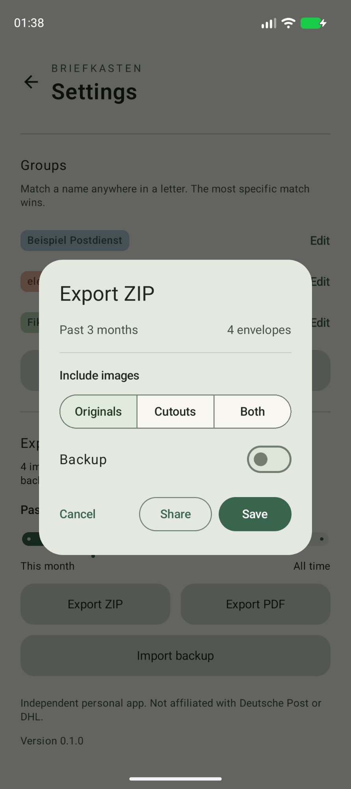

# Briefkasten

**Your post, collected.**

Know what’s on its way before you open the letterbox. Briefkasten notifies you about incoming mail with an envelope preview, and saves your DHL Briefankündigung images so you can keep them long after they disappear from DHL.

  
  &nbsp;
  
  &nbsp;
  

- **See what’s arriving:** Get notified about new mail, with the sender and an optional envelope preview right in your notifications.
- **Keep your mail history:** Automatically save new envelope previews and browse your archive by month, even offline.
- **Focus on the details:** Switch between the full image and a neatly cropped, straightened view. Zoom in whenever you need to.
- **Read and copy text:** On-device text recognition makes addresses and sender details selectable and easy to copy.
- **Keep things organized:** Create colored groups that automatically match senders by name.
- **Take your archive with you:** Save or share images as ZIPs, export searchable PDFs for a month or date range, or back up and restore your archive on another device.

Your saved images stay on your phone, encrypted, with an optional fingerprint, face, or PIN lock.

To get started, sign in with a DHL account that has Briefankündigung enabled. Available envelope previews are saved on your first check.

## A closer look

<table>
  <tr>
    <td align="center"> Full envelope</td>
    <td align="center"> Selectable recognized text</td>
    <td align="center"> Colored sender groups</td>
  </tr>
</table>

<table>
  <tr>
    <td align="center"> Notification and privacy settings</td>
    <td align="center"> Searchable PDF export</td>
    <td align="center"> Image export and backups</td>
  </tr>
</table>

---

Licensed under the [MIT License](LICENSE).
Briefkasten was written with the help of OpenAI Codex, including its code and documentation.
Independent app, not affiliated with Deutsche Post or DHL. Screenshots use fictional sample mail.
